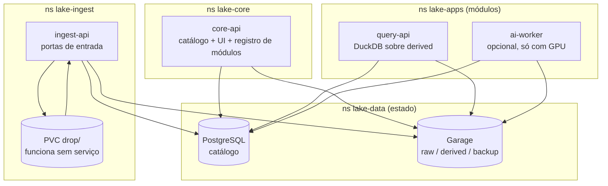

# Arquitetura v2 — datalake-doomsday

> **Status:** proposta de arquitetura final. Nada foi construído ainda.
> **Última revisão:** 2026-11-18.
>
> **Execução:** o andamento por onda, com o que já está pronto, fica em
> [`datalake-doomsday-env › docs/plano-atividades.md`](https://github.com/TheSeeds/datalake-doomsday-env/blob/main/docs/plano-atividades.md).
> Este documento descreve o **alvo**, não o estado. Onde os dois divergem,
> o plano tem razão.
> **Substitui:** o modelo de 3 VMs com Vagrant+libvirt descrito em
> `arquitetura.md`, `mvp.md`, `iac.md`, `infraestrutura-local.md` e `planodeiac.md`.
> Esses documentos permanecem como registro histórico até a migração ser validada.
>
> **Referência de produto:** [Project NOMAD](https://www.projectnomad.us/) (Apache 2.0).
> Copiamos o *modelo de distribuição* (engine pequeno + registro de módulos +
> instalador único + bundle offline). **Não** copiamos o modelo de dados — ver §12.

---

## 1. O que este sistema é

Um data lake instalável, operável e recuperável **sem internet**, em hardware
de 16–32 GB de RAM e ~500 GB de disco, que cresce adicionando nós.

Três afirmações que a arquitetura precisa sustentar:

1. **Instala sem internet.** Bundle versionado com engine, imagens, charts e seed.
2. **O dado bruto é o ativo.** Catálogo e derivados são reconstruíveis; o `raw/` não.
3. **Cresce por adição de nó**, não por reescrita.

O que ele **não** é: distribuidor de acervo curado (isso é o NOMAD), cluster de
alto desempenho, nem serviço multiusuário multi-tenant.

---

## 2. Eixos de parametrização

Quatro eixos independentes. A versão anterior desta conversa tratava tudo como
"perfis", o que estava errado — hardware pequeno com acervo grande é uma
combinação válida, e vice-versa.

| Eixo | Valores | Efeito |
|---|---|---|
| **Engine tier** | `micro` (16 GB) · `standard` (32 GB) · `cluster` (3+ nós) | limites de recurso, réplicas, `shared_buffers` |
| **Nodes** | 1 → N (microk8s) | capacidade de storage e de trabalho |
| **GPU** | `none` · `nvidia` · `amd` + **piso de VRAM** | habilita ou não módulos de IA |
| **Módulos** | `core` · `+ai` · `+maps` · `+extract` | serviços instalados |

`micro` + `none` + `core` = lake funcional em 16 GB sem GPU.
`cluster` + `nvidia` + `+ai` = busca semântica sobre o acervo.

> **Correção (2026-11-18):** a máquina de desenvolvimento **tem** GPU —
> RTX 3050 Laptop, 4 GB de VRAM, com ~3,5 GB ocupados por outro serviço.
> O eixo `gpu` sozinho é insuficiente: `nvidia` cobre tanto 4 GB quanto 24 GB.
> Módulos passam a declarar **piso de VRAM** (`requires.vram`), e módulo que não
> satisfaz o piso **recusa instalação** em vez de degradar para CPU em silêncio.
> Detalhes e medições: `plano-atividades.md` §11 no repo do ambiente.
>
> **Emenda 2 (mesma data):** existe um degrau utilizável em **4 GB** para LLM de
> 0,5–1,5B com `--enforce-eager` — medido em `vllm-doomsday/docs/resultados.md`.
> O módulo de IA, quando existir, roda sobre **vLLM** (teto de memória explícito
> e batching contínuo), falando API OpenAI. Ver ADR-010.

---

## 3. Topologia base

microk8s single-node hoje, com caminho de crescimento para N nós. Calico como CNI
— o que torna NetworkPolicy **efetiva** (diferente do k3d/flannel em uso no geoflow).



**Quatro namespaces, por fronteira de confiança** — não por conveniência:

| namespace | contém | por quê está separado |
|---|---|---|
| `lake-data` | Garage, PostgreSQL | estado. Só recebe tráfego dos outros três |
| `lake-ingest` | ingest-api, PVC `drop/` | recebe dado externo — superfície de ataque |
| `lake-core` | core-api (catálogo, UI, registro) | plano de controle |
| `lake-apps` | query-api, módulos | código de terceiros/opcional |

---

## 4. Camada de dados

### 4.1 Garage (S3)

Escolhido por uso prévio e por aderência ao problema: storage S3 leve, feito para
implantação geodistribuída pequena, sem a complexidade operacional de MinIO/Ceph.
Isso também resolve a dependência morta: o `minio/minio` está arquivado, sem
binários community e sem console de administração.

**Topologia:** `DaemonSet` com `hostPath`, não `StatefulSet`.

Justificativa: o modelo mental do projeto é *"adicionar nó = adicionar capacidade"*.
Com DaemonSet, todo nó novo já sobe com uma instância Garage; falta apenas
`garage layout assign` + `apply`. Com StatefulSet seria preciso dimensionar réplicas
e afinidade manualmente a cada nó.

**Separar meta e data** (recomendação oficial do Garage):

| volume | tipo | tamanho | conteúdo |
|---|---|---|---|
| `meta` | SSD/NVMe | 5–10 GiB | LMDB, metadados pequenos e quentes |
| `data` | HDD ou SSD | resto | blocos de objeto |

XFS é recomendado para `data`; EXT4 tem limites que o Garage não contorna.

**Decisão que precisa ser tomada na instalação:** o `replication_factor`.

- `1` — sem redundância. Um nó morto = dado indisponível.
- `2` — tolera 1 falha; leitura continua, escrita falha.
- `3` — tolera 2 falhas; requer 3 nós/zones.

E o fator **não pode ser alterado com dado dentro**: exige apagar o cluster layout
e rebalancear tudo, com indisponibilidade. Consequência prática, e é o ponto mais
importante deste documento:

> **Um lake single-node com rf=1 não é um lake "doomsday" — é um lake de preparação.**
> Enquanto não houver 3 nós, o `raw/` não deve conter nada insubstituível.
> O caminho honesto é: `micro`/rf=1 recebe dado de teste; rf=3 é habilitado junto
> com o terceiro nó, antes da primeira coleta irreversível.

O instalador deve **perguntar e registrar** o rf escolhido, e o dashboard deve
mostrar laranja/vermelho enquanto `rf=1`.

### 4.2 Buckets e zonas

Três buckets, com ciclos de vida opostos:

| bucket | conteúdo | política |
|---|---|---|
| `raw` | cópia fiel do original, imutável | **nunca apagar.** WORM por política de escrita |
| `derived` | Parquet, extrações, índices | regenerável; pode ser apagado por inteiro |
| `backup` | dumps do PostgreSQL, snapshots de layout | retenção definida, rotação por cron |

Layout determinístico no `raw`:

```
raw/{origem}/{tipo}/{YYYY}/{MM}/{DD}/{sha256}
```

Determinístico, idempotente e portável entre Garage e qualquer S3. O `sha256`
como nome de objeto elimina duplicação de graça.

### 4.3 PostgreSQL

Instância única em `StatefulSet` com PVC. `shared_buffers` derivado do engine tier
(512 MB em `micro`, 2 GB em `standard`).

Responsabilidade: **apenas o catálogo** — proveniência, estado, hashes, metadados.
Derivados analíticos ficam em Parquet no `derived/`; o Postgres não é o motor
analítico.

Backup: `pg_dump` por CronJob → `backup/` no Garage, mais arquivamento de WAL.
Não é o backup mais sofisticado possível; é o que se testa em 5 minutos.
Operador dedicado (CloudNativePG) fica como decisão futura — ver §13.

---

## 5. Camadas de acesso

Três pontos de imposição independentes. Um só vazando, a camada não existe.

| ponto | mecanismo | o que governa |
|---|---|---|
| 1. Rede | NetworkPolicy (Calico) | quem alcança quais pods |
| 2. Objeto | chave S3 do Garage, por bucket+prefixo | quem lê/escreve qual zona |
| 3. Catálogo | role do PostgreSQL | quem consulta/insere qual tabela |

Matriz de papéis:

| papel | `raw/` | `derived/` | catálogo | egress | ns |
|---|---|---|---|---|---|
| `ingest` | **write-only** | — | INSERT | só `lake-data` | `lake-ingest` |
| `analyst` | ✗ | read | SELECT | só `lake-data` | `lake-apps` |
| `ai-worker` | read | read/write | SELECT | **none** | `lake-apps` |
| `admin` | read | read | ALL | — | `lake-core` |

Detalhes que importam:

- `ingest` **escreve sem ler** `raw/`. Isso impede que um ingestor comprometido
  exfiltre o acervo. Garage suporta via política de chave por prefixo.
- `ai-worker` roda com `egress: []`. Um modelo não precisa de rede.
- Nenhum pod enxerga credencial de outro papel: uma `Secret` por papel, montada
  apenas no pod correspondente.

**Fricção deliberada:** leitura na LAN é livre (sem conta, como no NOMAD);
escrita, ingestão e qualquer operação destrutiva exigem token. Dois níveis, não seis.

---

## 6. Portas de entrada

Um primitivo (`upload`), quatro caminhos. A diferença em relação ao NOMAD é que
**um deles funciona com o serviço morto**.

| porta | cenário | precisa de pod no ar |
|---|---|---|
| `drop/` (PVC) | pendrive, disco que chega, máquina sem rede | **não** |
| `POST /uploads` | app, sensor, integração HTTP | sim |
| `datalake push ./dir` | operação manual | **não** (escreve no `drop/`) |
| conector de saída | puxar de fonte externa | sim, e só com rede |

O `drop/` é o requisito de arquitetura que diferencia este projeto: em cenário
degradado, alguém copia arquivos numa pasta e o dado entra. Um `CronJob` (ou o
`ingest-api`, quando vivo) varre a pasta, calcula hash, move para `raw/` e cataloga.

Máquina de estados única, idempotente por `sha256`:

```
received → hashed → stored(raw) → cataloged → processing → done
                                              ↘ failed (com motivo)
```

---

## 7. Registro de módulos

O equivalente ao "Supply Depot" do NOMAD, e o que faz um ambiente ser *replicável*
em vez de ser um `docker-compose.yml` glorificado.

```yaml
# módulos/ai-assistant/module.yaml
name: ai-assistant
version: 0.1.0
requires:
  gpu: optional          # degrada para CPU ou fica desligado
  disk: 25Gi
  ram: 6Gi
provides:
  - busca-semantica
  - sumarizacao
install:
  chart: charts/ai-assistant
  values: profiles/{engine}-{gpu}.yaml
health:
  endpoint: /health
uninstall:
  keeps: [derived/embeddings]   # dado derivado sobrevive à remoção
```

Regra que o NOMAD acerta e devemos copiar: **desinstalar um módulo não apaga dado
do usuário.** Sempre `keeps`.

Módulos previstos, nesta ordem: `extract-text` (Tika), `ai-assistant` (Ollama +
pgvector ou Qdrant), `maps`, `export-parquet`.

---

## 8. Empacotamento e instalação

### 8.1 A distro é o produto

```
datalake-distro/
  versions.yaml          pin de tudo: imagens por digest, chart versions, rev do snap
  charts/
    datalake/            umbrella chart
    garage/              chart pinado (vendorizado)
  modules/               definições de módulo
  profiles/
    micro.yaml  standard.yaml  cluster.yaml  gpu.yaml
  seed/                  DataSet de demonstração
  scripts/
    install.sh           idempotente
    verify.sh            checksum → instala → smoke → relatório
    bundle.sh            monta o .tar de airgap
    layout.sh            garage layout assign/apply (o Helm não faz)
```

`versions.yaml` é o arquivo que sustenta a promessa "replicável em 2027".
Imagem sem digest está proibida.

### 8.2 Bundle offline

```
datalake-1.0.0-offline-amd64.tar.zst
├── MANIFEST.json      versões, digests, commit, data de build
├── SHA256SUMS
├── snaps/             microk8s.snap + core*.snap + .assert   (airgap oficial Canonical)
├── images/            images.tar  ← microk8s images export-local + cargas
├── distro/            datalake-distro completo, pinado
├── seed/
├── install.sh         --engine micro|standard|cluster  --gpu none|nvidia|amd
└── verify.sh
```

`verify.sh` roda em máquina **sem rede** e é o gate de release. Sem ele verde,
o bundle não recebe tag. "Instalável sem internet" é afirmação testável — tratá-la
como promessa não testada é exatamente o erro do `estado-validado.md` atual.

### 8.3 Instalação

Alvo: dois comandos, como no NOMAD.

```bash
sudo snap install microk8s --classic --channel=1.35/stable   # do bundle, offline
sudo bash install.sh --engine standard --gpu none --profile core
```

`install.sh` habilita addons (`dns`, `hostpath-storage`, `helm`, `rbac`, `ingress`,
`cert-manager`), aplica secrets, instala o chart, roda `layout.sh` e valida.

**Snap `classic`, não `strict`.** O snap estritamente confinado bloqueia workloads
que pedem shared mount com o host, e os addons afetados incluem `gpu` — justamente
o que precisamos deixar disponível para o eixo GPU. O próprio `install.sh` deve
recusar rodar contra um snap `*-strict`.

Detalhe obrigatório: **o Garage exige `layout assign` + `layout apply` fora do Helm.**
Sem esse passo o cluster sobe "verde" e não armazena nada. É o tipo de falha
silenciosa que precisa virar teste.

### 8.4 Homologação de sistema operacional

O código é agnóstico; a **matriz de homologação** não é. Falha de orquestrador
raramente aparece no `install.sh` — aparece na operação, semanas depois.

| nível | plataforma | o que garante |
|---|---|---|
| **Tier 1 — homologado** | **Ubuntu Server 24.04 LTS** (kernel HWE) | `verify.sh` verde em máquina limpa, sem rede, na CI mensal. É o único alvo de release |
| **Tier 2 — suportado** | Ubuntu Server 26.04 LTS | mesma receita, validado a cada release maior |
| **Tier 3 — funciona, não homologado** | Fedora no host do autor | onde o autor desenvolve; pode quebrar após upgrade de distro |
| **Não suportado declarado** | Raspberry Pi, arm64, macOS | `arm64` está na doc oficial do microk8s, mas não é alvo de v1 |

Por que Ubuntu como Tier 1, e não Fedora de propósito:

1. **AppArmor.** O snap do microk8s depende dele. Fedora usa **SELinux Enforcing
   com AppArmor inativo** — a confinação nunca é exercida nas mesmas condições.
2. **Origem do fornecedor.** Ubuntu é a plataforma em que o microk8s é
   desenvolvido e testado; em outras distros a própria Canonical descreve o
   suporte como "best-effort".
3. **Reprodutibilidade.** O bundle precisa de **uma** combinação de kernel +
   confinamento para a qual "verde" significa alguma coisa.

### 8.5 Dois ambientes de trabalho, com finalidades distintas

| ambiente | onde | para quê |
|---|---|---|
| **dev loop** | Fedora host, microk8s snap já instalado | escrever charts, iterar manifests, medir. Rápido, sem VM |
| **homologação** | Ubuntu Server 24.04 em VM (libvirt já ativo: pool `default`) | única fonte de verdade do "funciona" |

Regra honesta: **o que quebra no Fedora não é bug do projeto, é desvio de matriz.**
Se quebrar no Ubuntu, é bug. Registrar assim evita meses gastos depurando
idiossincrasia de distro.

O host já tem `libvirt` ativo com pool `default` e a box `generic/debian12`
baixada. Para homologar, basta uma box Ubuntu 24.04:

```bash
vagrant box add generic/ubuntu2404 --provider=libvirt
```

Essa VM não substitui o alvo real de hardware modesto — ela valida o
*instalador*. A validação de hardware modesto é um item separado (§13).

---

## 9. Dimensionamento (16 GB / 500 GB)

Disco:

| item | tamanho |
|---|---|
| SO + microk8s + imagens | 20 GB |
| PostgreSQL (`micro`/`standard`) | 10 GB |
| Garage `meta` | 5 GiB |
| **Garage `data`** | **~400 GB** |
| margem (upgrades, dumps temporários) | 50 GB |

400 GB com `rf=1` = 400 GB úteis. Com `rf=3` em 3 nós de 500 GB = 1,2 TB brutos,
400 GB úteis. **A redundância custa 2/3 da capacidade bruta — é o preço, e o
dimensionalmente tem que aparecer na doc, não ser descoberto depois.**

RAM em 16 GB:

| componente | reserva |
|---|---|
| microk8s + Calico + CoreDNS | 1,5 GB |
| PostgreSQL | 2 GB |
| Garage (`block_ram_buffer_max` 256 MiB + folga) | 1 GB |
| core-api + ingest-api | 1,5 GB |
| sistema operacional | 2 GB |
| folga | 8 GB |

Cabe. Com 32 GB, o excedente vai para PostgreSQL e para módulos de IA.

---

## 10. Máquinas de decisão testáveis

O padrão mais reaproveitável do NOMAD: testar a **decisão** sem executar a ação.

Aplicamos a três operações perigosas:

| máquina | entradas | decisão | como testar offline |
|---|---|---|---|
| retenção | idade, bucket, política | apagar / reter | `--now` fixo + claims engessadas |
| auto-update | versão atual, janela, cool-off | atualizar / não | `--releases-file` com lista local |
| restore | snapshot, integridade | restaurar / abortar | fixtures de dump |

Veredicto impresso em formato legível (`WOULD DELETE 1.2k objetos`, `WOULD SKIP:
outside-window`), com `--dry-run` como default. **Nenhuma operação destrutiva
executa sem `--apply` explícito** — o que também satisfaz a guardrail de
bloqueio de comando destrutivo.

---

## 11. Operação

| rotina | mecanismo | frequência |
|---|---|---|
| backup do catálogo | CronJob `pg_dump` → `backup/` | diário |
| snapshot do layout Garage | `garage layout show` → `backup/` | a cada mudança |
| verificação de integridade | `garage repair --dry-run` + contagem de objetos | semanal |
| retenção | máquina de decisão (acima) | semanal |
| restore drill | cluster limpo + `verify.sh` | mensal |

**3-2-1 mínimo:** `raw/` no Garage + cópia em disco externo + backup do catálogo.
Um lake "doomsday" com uma cópia é uma promessa que não se sustenta.

---

## 12. Crescimento: 1 → N nós

Primeiro nó (`microk8s` já rodando nesta máquina: `zoio`, v1.31.14).

```bash
microk8s add-node                     # no nó 1, gera token
microk8s join <ip>:25000/<token>      # no nó 2
```

Consequências que precisam estar documentadas antes do primeiro `join`:

- **dqlite quer número ímpar de nós votantes.** 2 nós não dão HA; dão 1 votante
  + 1 standby. HA real a partir de 3.
- Todo nó novo recebe uma instância Garage (DaemonSet) e precisa de
  `layout assign` + `apply` para entrar na conta de capacidade.
- `replication_factor` só muda com rebalanceamento destrutivo. **Decidir antes.**

Runbook de mudança de rf fica como item separado, com teste — não como passo
"fácil" no meio de um parágrafo.

---

## 13. Decisões tomadas e decisões abertas

**Tomadas:**

| decisão | escolha | motivo |
|---|---|---|
| Orquestrador | microk8s | snap único, airgap oficial, amd64+arm64, cresce por nó |
| Rota de deploy | **só microk8s** | uma rota; compose duplicaria manutenção |
| Object store | Garage, DaemonSet + hostPath | uso prévio, leve, aderente a hardware modesto |
| Buckets | `raw` / `derived` / `backup` | ciclos de vida distintos |
| Acesso | 3 pontos (rede, objeto, catálogo) | um só não basta |
| Auth | leitura LAN livre; escrita com token | não pagar fricção onde o NOMAD não paga |
| Licença | Apache 2.0 | precedente do NOMAD |
| Kubernetes | `1.35/stable` pinado | canal mais recente com ≥2 revisões estáveis; 1.31 saiu da janela |

**Abertas (precisam de decisão antes da implementação):**

1. **Operador de PostgreSQL** — StatefulSet + CronJob (simples, testável) ou
   CloudNativePG (PITR, failover, backup nativo para S3)? Hoje a proposta é
   StatefulSet; CNPG fica como evolução quando o catálogo virar insubstituível.
2. **Busca semântica** — pgvector (menos um serviço) ou Qdrant (como o NOMAD)?
   Recomendação: pgvector até doer.
3. **`drop/` como PVC** — PVC `ReadWriteMany` é caro/limitado em microk8s.
   Alternativa: `hostPath` no nó que recebe a mídia física. Decidir quando houver
   o primeiro caso de uso real.
4. **GPU AMD** — microk8s tem addon oficial para NVIDIA; AMD exige device plugin
   manual. Sem demanda, AMD fica fora da matriz de homologação.
5. **Piso de VRAM por módulo** — `requires.vram` no `module.yaml`. A máquina de
   desenvolvimento tem 4 GB e já usa ~3,5 GB, então o primeiro módulo com piso
   realista (embed pequeno, 2 GB) só é viável com a GPU livre. Definir se o
   instalador **recusa** ou **avisa** quando o piso não é satisfeito — a proposta
   é recusar (ver §7).

---

## 14. Fora do escopo da v1

Registrado para não virar expectativa:

- Multi-tenant (duas famílias / duas organizações no mesmo lake)
- HA do plano de controle (exige 3 nós; v1 é single-node)
- Replicação entre clusters (geodistribuição)
- TLS público com domínio (v1 é LAN + certificado interno)
- Interface de escrita para usuário final
- Busca semântica em produção
- **Homologação em hardware físico modesto** — `verify.sh` roda em VM do host de
  desenvolvimento. Uma máquina de 16 GB / 500 GB real pode ter I/O de disco,
  firmware e limites de cgroup diferentes da VM. Enquanto essa execução não
  acontecer, "cabe em 16 GB" é estimativa de dimensionamento, não fato medido.

---

## 15. Divergência explícita do Project NOMAD

| | Project NOMAD | datalake-doomsday |
|---|---|---|
| acervo | curado (Wikipedia, Khan, OSM) | **o dado do usuário, heterogêneo** |
| primitivo central | download de pacote | **ingestão → hash → catálogo → proveniência** |
| catálogo | inexistente (ZIM é opaco) | **é o produto** |
| deduplicação | n/a | por `sha256` |
| retenção | n/a | política explícita e testável |
| instalável sem internet | ✗ (exige rede no install) | **✓ bundle offline** |
| acesso | sem auth por design | escrita autenticada |
| hardware alvo | PC x86 com GPU | 16 GB / 500 GB, GPU opcional |

A tese em uma frase: **Project NOMAD para o seu próprio acervo.**
Ele distribui conhecimento já conhecido; nós catalogamos o que ainda não é.
