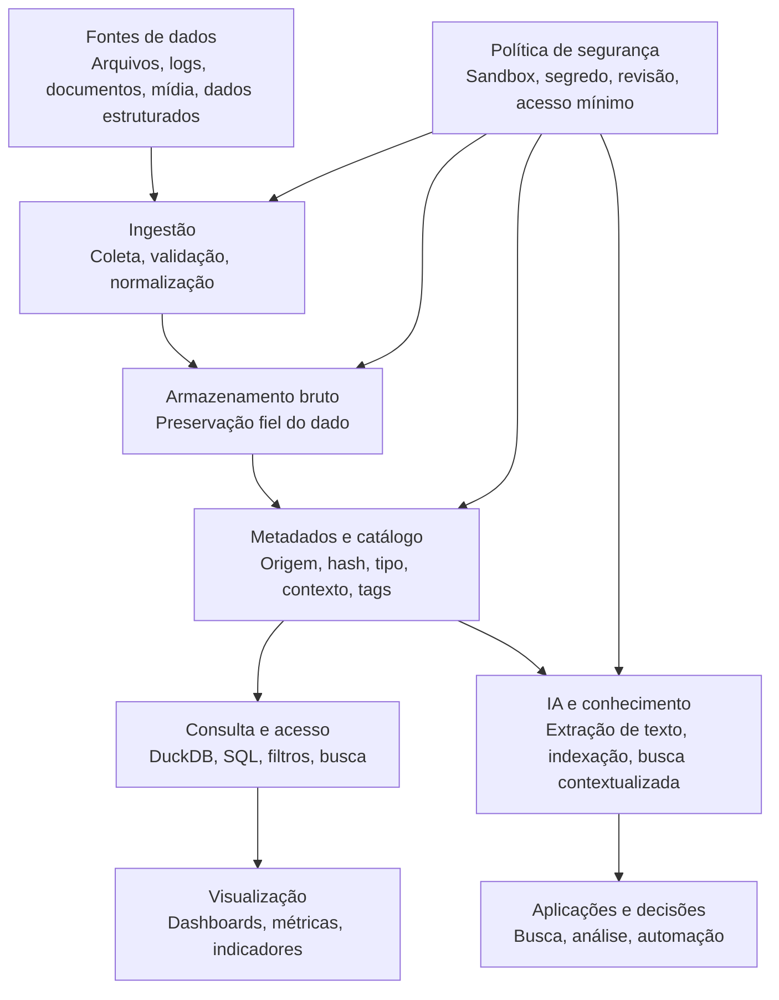
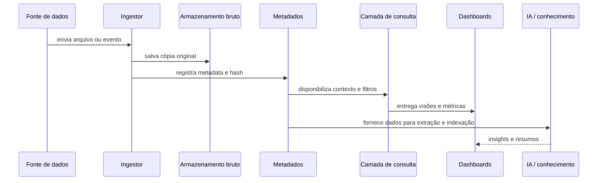
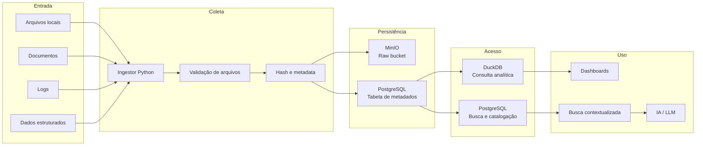

# Arquitetura do projeto

## Visão geral

A arquitetura do datalake-doomsday foi pensada para ser simples, resiliente e implementável em etapas. O objetivo central é separar com clareza o que é dado bruto, o que é metadado, o que é consulta e o que vira conhecimento útil para análise e IA.

A proposta não é uma plataforma complexa desde o início. A proposta é uma arquitetura modular em camadas, que cresce conforme a necessidade real do projeto.

## Compromisso de arquitetura aberta

A arquitetura deste projeto deve ser 100% compatível com software livre e open source.

Isso significa:

- evitar dependências proprietárias onde não for necessário
- priorizar ferramentas com licença aberta
- manter módulos reutilizáveis e auditáveis
- garantir que a solução possa ser reproduzida em qualquer ambiente
- favorecer interoperabilidade e transparência técnica

## Diagrama arquitetural em camadas

## Fluxo de funcionamento

## Camadas propostas

### 1. Camada de ingestão

Responsável por receber dados de diferentes fontes e formatos.

Inclui:

- arquivos locais
- documentos de texto
- PDFs e imagens
- logs e eventos
- arquivos estruturados e semiestruturados
- conteúdos sem origem definida ou com contexto parcial

Objetivos:

- capturar o dado sem perder informação
- validar integridade mínima
- registrar origem e timestamp
- preparar o dado para armazenamento bruto

### 2. Camada de armazenamento bruto

Responsável por preservar o dado original com integridade e rastreabilidade.

Objetivos:

- manter uma cópia fiel do dado original
- separar armazenamento bruto de dados processados
- preservar contexto de cada arquivo ou item
- permitir auditoria e recuperação simples

Requisitos:

- armazenamento barato
- fácil recuperação
- retenção por categoria
- rastreio por hash e metadata

### 3. Camada de metadados e catalogação

Responsável por organizar o contexto do dado.

Deve registrar:

- origem
- tipo
- data de coleta
- formato
- hash
- tamanho
- categoria
- tags
- status de processamento
- política de retenção
- responsável pela coleta

Esta camada é o coração do lake, porque é ela que transforma dados crus em algo pesquisável e compreensível.

### 4. Camada de consulta e acesso

Responsável por permitir leitura analítica e contextualizada.

Pode incluir:

- consultas SQL
- leitura estruturada
- filtros por origem, data e tipo
- busca por texto
- consultas analíticas leves
- cruzamento entre dados e metadados

O foco inicial não deve ser um sistema de análise gigantesco. O foco deve ser algo útil, simples e confiável.

### 5. Camada de visualização e dashboards

Responsável por transformar os dados em informações legíveis.

Inclui:

- métricas gerais
- volume por categoria
- evolução temporal
- frequência de origem
- volume por tipo de dado
- status de ingestão
- indicadores operacionais

Objetivo:

- mostrar a saúde do sistema
- evidenciar lacunas e padrões
- dar visibilidade para operação e revisão

### 6. Camada de IA e base de conhecimento

Responsável por preparar o lake para uso futuro por IA e busca semântica.

Inclui:

- extração de texto
- OCR e parsing de documentos
- indexação por contexto
- busca semântica
- sumarização
- associação entre dados e metadados
- exploração por assunto e tema

Essa camada não deve ser a primeira dependência crítica do projeto; ela deve ser construída sobre uma base de dados bem catalogados e bem organizados.

## Arquitetura recomendada para o primeiro protótipo

A implementação inicial deve ser modular, mas bem definida. A ideia é entregar algo que funcione de verdade, sem criar um sistema pesado demais antes de validar a ideia.

## Modelo de infraestrutura alvo

O padrão arquitetural do projeto será a separação em 3 máquinas virtuais, como modelo de referência para operação e crescimento:

### VM 1 - armazenamento e catálogo

- MinIO
- PostgreSQL
- função: preservar o dado bruto e manter o catálogo de metadados

### VM 2 - aplicação e consulta

- Python
- DuckDB
- dashboard básico
- função: receber arquivos, processar metadados e consultar dados de forma leve

### VM 3 - sandbox e IA

- ai-jail
- atividades de extração de texto e processamento inteligente
- função: manter a execução segura, isolada e com acesso controlado

Essa estrutura evita misturar responsabilidades e reduz risco de falha operacional, além de manter a arquitetura alinhada com as práticas de segurança do projeto.

### Stack proposta inicial

- Armazenamento bruto: MinIO
- Metadados e catálogo: PostgreSQL
- Consulta analítica leve: DuckDB
- Extração de texto: Apache Tika
- Indexação de busca: PostgreSQL + pgvector ou Meilisearch
- Orquestração simples: Python + scripts + cron ou task runner leve
- Contêineres: Docker / Docker Compose

### Por que essa stack?

- MinIO é simples de operar e compatível com S3
- PostgreSQL é confiável e bem conhecido
- DuckDB é excelente para análise leve e local
- Apache Tika é útil para extrair texto de documentos heterogêneos
- a combinação é de baixo custo, rápida de prototipar e bem adequada ao objetivo do projeto

## Visão funcional da arquitetura

## Princípios arquiteturais

O projeto deve seguir estes princípios:

1. preservar o dado bruto antes de transformar
2. separar dados crus de dados processados
3. catalogar tudo que entra no sistema
4. manter metadados como base da organização
5. permitir consultas simples antes de soluções complexas
6. evoluir por módulos, não por reescrita total
7. priorizar soluções de código aberto e auditáveis
8. manter o projeto seguro por projeto, com acesso mínimo

## Definição de responsabilidade por camada

| Camada | Responsabilidade | Objetivo principal |
| --- | --- | --- |
| Ingestão | capturar e validar dados | entrada confiável |
| Armazenamento bruto | preservar original | integridade e rastreio |
| Metadados | contextualizar dados | organização e busca |
| Consulta | permitir acesso analítico | leitura eficiente |
| Visualização | expor métricas e contexto | compreensão operacional |
| IA / conhecimento | preparar dados para análise semântica | uso inteligente |

## Fases de construção

### Fase 1: base funcional mínima

Objetivo: validar a lógica básica do lake.

Entregáveis:

- coleta de arquivos locais
- armazenamento bruto em MinIO
- registro em PostgreSQL
- tabela de metadados básica
- busca simples por origem e tipo

### Fase 2: consulta e visão

Objetivo: tornar os dados úteis para uso humano.

Entregáveis:

- consultas com DuckDB
- agregações e métricas
- dashboards simples
- filtros por tipo e data

### Fase 3: indexação e IA

Objetivo: preparar para uso contextual e semântico.

Entregáveis:

- extração de texto
- indexação de documentos
- busca contextualizada
- base de conhecimento mínima
- integrações com agentes ou ferramentas IA

## Critérios de sucesso

A arquitetura será considerada adequada quando:

- os dados brutos forem preservados sem perda
- o catálogo for suficiente para localizar qualquer item
- a consulta for simples e confiável
- o sistema puder evoluir sem reescrever tudo
- a arquitetura seguir o padrão open source e segurança por default

## Decisão final de arquitetura

A arquitetura do datalake-doomsday deve seguir o modelo de lake modular com estas regras:

- dado bruto em uma camada separada
- metadados em uma camada estruturada
- consulta em uma camada analítica leve
- dashboards em uma camada visual
- IA apenas sobre uma base bem catalogada

Isso mantém o projeto viável, implementável e ainda compatível com o futuro.
