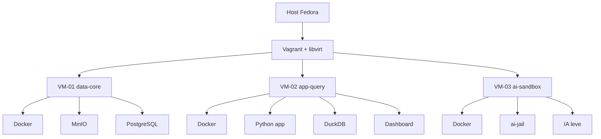

# Infraestrutura local do projeto

## Visão geral

Este documento explica como o ambiente local do datalake-doomsday deve ser montado, com foco em um ambiente simples, seguro e reprodutível em desenvolvimento.

Este ambiente é um ambiente de teste local, não de produção.

Ele é usado para validar a arquitetura do MVP, os fluxos de ingestão e consulta, e a separação lógica entre dados, metadados e IA.

A ideia central é usar:

- Vagrant para criar as VMs
- libvirt como backend local da virtualização
- Docker dentro das VMs para rodar os serviços
- IaC para automatizar a configuração e reduzir erro manual

## Arquitetura local

## Padrão de rede local

A rede local deve ser privada e escalável:

- VM-01: 192.168.56.10
- VM-02: 192.168.56.11
- VM-03: 192.168.56.12

Esses endereços são apenas de referência para ambiente local e não devem ser usados como rede pública ou de produção.

## Camadas da infraestrutura

### Camada 1: virtualização

Responsável por criar a base das VMs.

Ferramenta:

- Vagrant
- libvirt

Objetivo:

- criar VM com tamanho correto
- separar responsabilidades por função
- reduzir risco de contaminação entre ambientes

### Camada 2: provisionamento

Responsável por configurar a VM e instalar dependências.

Ferramenta:

- Ansible
- scripts bash pequenos e versionados

Objetivo:

- instalar Docker
- configurar usuário do projeto
- ajustar rede e DNS
- preparar ambiente de execução

### Camada 3: serviços

Responsável pelo runtime da aplicação.

Ferramenta:

- Docker
- Docker Compose

Objetivo:

- rodar MinIO, PostgreSQL, dashboard e serviços de processamento
- manter serviços isolados por ambiente

### Camada 4: segurança e IA

Responsável por limitar execução e reforçar isolamento.

Ferramenta:

- ai-jail
- política de acesso mínimo
- controle de comando destrutivo

Objetivo:

- impedir execução perigosa
- separar IA de dados críticos
- proteger o estado do sistema

## Ordem de implementação

1. Criar VMs com Vagrant
2. validar libvirt e pool de storage
3. provisionar Debian dentro das VMs
4. instalar Docker
5. configurar rede interna
6. instalar MinIO e PostgreSQL na VM-01
7. instalar app e dashboard na VM-02
8. instalar ai-jail e IA leve na VM-03
9. validar ingestão e consulta
10. validar segurança e automação

## Regras de uso local

- manter o ambiente local em desenvolvimento em node isolado
- não usar a VM local para dados sensíveis de produção
- não rodar modelos pesados fora do ambiente controlado
- não permitir execução destrutiva sem explicação e aprovação
- manter tudo documentado em repositório

## Conclusão

A infraestrutura local do projeto deve ser simples, previsível e versionada.

A abordagem recomendada é:

- VMs como fronteira
- Docker como runtime
- IaC como padrão
- segurança e documentação como parte da base do ambiente
