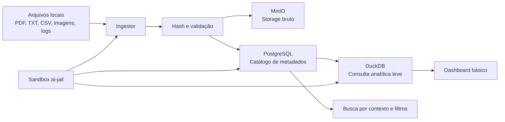
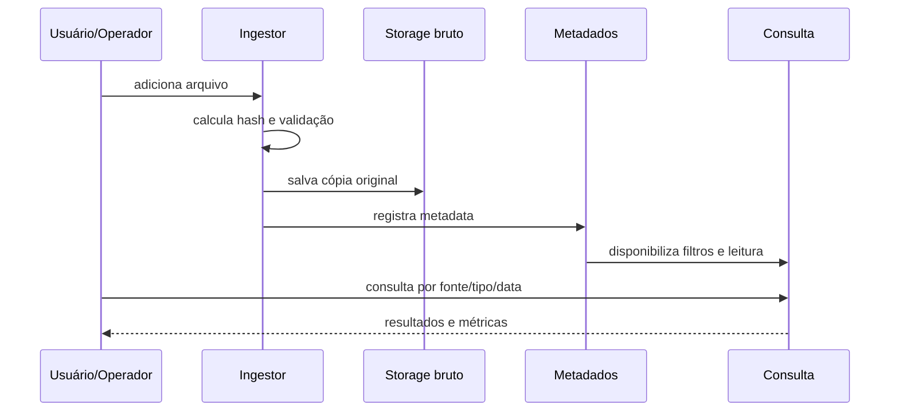

# MVP do datalake-doomsday

## Objetivo do MVP

O objetivo do MVP é provar que a arquitetura do projeto funciona em um cenário real, simples e controlado.

O resultado esperado é um protótipo funcional que permita:

- receber arquivos de origem variada
- preservar o dado bruto em um armazenamento seguro
- registrar metadados e contexto em um catálogo
- consultar o conteúdo e os metadados de forma simples
- abrir espaço para evolução futura em dashboards, busca e IA

Este MVP não tenta resolver tudo. Ele procura validar a base do projeto com menor risco, menor custo e maior clareza.

## Definição do problema

O projeto precisa demonstrar que é possível:

- coletar dados heterogêneos
- evitar perda de informação
- manter rastreabilidade do dado
- separar armazenamento bruto de dados organizados
- consultar o conteúdo com baixa complexidade operacional

## Escopo do MVP

### Incluído no MVP

- ingestão local de arquivos
- preservação do arquivo original em storage bruto
- cálculo de hash por arquivo
- registro de metadados em banco relacional
- catalogação por origem, tipo, data e categoria
- consulta simples por filtros
- visualização de métricas básicas
- documentação de execução e guardrails

### Fora do escopo do MVP

- cluster distribuído
- alta disponibilidade complexa
- suporte avançado para milhares de usuários simultâneos
- tabela em formato Iceberg completo
- busca semântica avançada
- IA operacional em produção
- dashboards sofisticados de negócio

## Arquitetura do MVP

## Componentes do MVP

### 1. Ingestor

O ingestor será responsável por:

- detectar arquivos novos
- validar extensão e tipo
- calcular hash e tamanho
- registrar timestamp de ingestão
- enviar o arquivo para o storage bruto
- encaminhar os metadados para o catálogo

### 2. Storage bruto

A camada bruta deve manter a cópia original do dado sem processamento agressivo.

Requisitos:

- persistência simples
- integração com S3-compatible storage
- baixa complexidade operacional
- suporte à auditoria

Tecnologia sugerida:

- MinIO

### 3. Catálogo de metadados

Essa camada vai guardar toda a estrutura de contexto do sistema.

Informações mínimas:

- id do item
- nome do arquivo
- origem
- tipo de dado
- tamanho
- hash
- data de ingestão
- categoria
- tags
- status
- caminho no storage bruto

Tecnologia sugerida:

- PostgreSQL

### 4. Consulta leve

A camada de consulta deve permitir:

- listar arquivos por categoria
- filtrar por origem e data
- contar itens por tipo
- consultar metadados estruturados
- fazer leitura analítica básica

Tecnologia sugerida:

- DuckDB

### 5. Dashboard básico

O dashboard inicial deve mostrar:

- quantidade total de arquivos
- volume por categoria
- volume por origem
- número de arquivos por tipo
- status de ingestão
- últimas entradas

### 6. Segurança e sandbox

Toda a execução do MVP deve respeitar a política do projeto, inclusive:

- uso de ai-jail para atividade de IA e processamento
- acesso mínimo e por projeto
- dados sensíveis não expostos por padrão
- revisão humana antes de ações críticas

## Fluxo operacional do MVP

## Entregáveis do MVP

### Entregável 1: coleta funcional

- ingestão de arquivo local simples
- armazenamento bruto preservado
- metadados registrados

### Entregável 2: catalogação funcional

- estrutura de tabela para metadados
- busca por categoria, tipo e origem
- rastreio por hash e data

### Entregável 3: consulta funcional

- consultas SQL simples
- métricas básicas
- exploração de dados por contexto

### Entregável 4: visão operacional

- painéis simples
- indicadores de ingestão e uso

### Entregável 5: documentação e segurança

- guia de execução
- uso do sandbox
- regras de operação e acesso

## Critérios de aceitação

O MVP será considerado concluído quando:

- for possível adicionar arquivos em um diretório local e processá-los
- o dado bruto for preservado sem alteração
- cada item tenha registro de metadata e hash
- a consulta por origem, tipo e data funcionar
- exista um painel simples com métricas mínimas
- a execução esteja protegida por sandbox e guardrails
- a documentação permita reproduzir o projeto em outra máquina

## Critérios de qualidade

- simplicidade operacional
- rastreabilidade dos dados
- ausência de dependência de cluster pesado
- fluxo de execução previsível
- fácil extensão para futuras camadas

## Fase de maturação após o MVP

Após o MVP concluído, o projeto pode evoluir para:

- busca por conteúdo textual
- indexação e extração de texto
- suporte a mais fontes e formatos
- dashboards mais ricos
- IA e base de conhecimento
- extensão para lakehouse mais formal

## Decisão de arquitetura para o MVP

A arquitetura escolhida para o MVP é:

- MinIO para armazenamento bruto
- PostgreSQL para metadados e catálogo
- DuckDB para consulta leve
- Python para ingestão e orchestration
- Docker Compose para execução local

Essa escolha é simples, barata e adequada ao objetivo de provar a ideia sem excesso de complexidade.

## Próxima etapa

A próxima etapa é a implementação do código e da infraestrutura mínima do MVP, começando por:

1. estrutura de diretórios do projeto
2. serviço de ingestão
3. schema do catálogo em PostgreSQL
4. storage bruto com MinIO
5. consulta básica com DuckDB
6. dashboard simples de métricas

## Resumo executivo

O MVP do datalake-doomsday é um protótipo funcional de lake modular com foco em:

- preservação do dado bruto
- catalogação confiável
- consultas simples
- visualização básica
- segurança por default

É a base para provar a arquitetura e preparar a evolução do projeto sem cair em overengineering desde o início.
